# 🏛️ ClubSync Database Structure Snapshot (Pre-DBMS Course Project & Event Cycle Update)

> **Document Type:** Canonical Database Structure Baseline & Data Dictionary  
> **Snapshot Date:** November 15, 2026  
> **Source Target:** PostgreSQL 15 / Supabase  
> **Backup Directory:** [`database/backup_pre_dbms_update/`](file:///c:/Users/prana/OneDrive/Desktop/Clubsync/database/backup_pre_dbms_update)  
> **Status:** LOCKED & ARCHIVED FOR REFERENCE BEFORE EVENT CYCLE & DBMS OVERHAUL  

---

## 1. Executive Summary & Architectural Overview

This document captures the complete active database structure of **ClubSync** prior to refactoring for the **Event Lifecycle Engine** and academic **DBMS Course Project** requirements (Normalization, ACID guarantees, Transaction Schedules, Functional Dependencies, Relational Algebra, and Stored Procedures).

ClubSync is a campus management platform connecting students, student clubs, faculty mentors, resource administrators, and institutional leadership. The database currently comprises **26 relational tables**, **2 analytical views**, **7 stored procedures / RPC functions**, **1 venue conflict detection trigger**, and **Supabase Realtime publications**.

---

## 2. Entity-Relationship Diagram (Current Architecture)

```mermaid
erDiagram
    COLLEGES ||--o{ USERS : "enrolls"
    COLLEGES ||--o{ CLUBS : "hosts"
    USERS ||--o{ MEMBERSHIPS : "holds"
    CLUBS ||--o{ MEMBERSHIPS : "has"
    CLUB_ROLES ||--o{ MEMBERSHIPS : "defines_role"
    CLUBS ||--o{ CLUB_FOLLOWERS : "followed_by"
    USERS ||--o{ CLUB_FOLLOWERS : "follows"
    
    CLUBS ||--o{ EVENTS : "organizes"
    COLLEGES ||--o{ EVENTS : "locates"
    VENUES ||--o{ EVENTS : "reserves_space"
    
    EVENTS ||--o{ EVENT_APPROVALS : "reviewed_in"
    USERS ||--o{ EVENT_APPROVALS : "approved_by"
    EVENTS ||--o{ EVENT_AUDIT_LOG : "audited_by"
    EVENTS ||--o{ EVENT_VERSIONS : "versioned_in"
    
    EVENTS ||--o{ TICKETS : "issues"
    EVENTS ||--o{ EVENT_REGISTRATIONS : "attended_by"
    TICKETS ||--o{ EVENT_REGISTRATIONS : "tier_selected"
    USERS ||--o{ EVENT_REGISTRATIONS : "registers"
    
    EVENTS ||--o{ EVENT_TEAMS : "staffed_by"
    USERS ||--o{ EVENT_TEAMS : "works_in"
    EVENTS ||--o{ EVENT_TASKS : "breaks_into"
    USERS ||--o{ EVENT_TASKS : "assigned_to"
    EVENTS ||--o{ EVENT_BUDGETS : "budgeted_for"
    EVENTS ||--o{ EVENT_SETTLEMENTS : "settles_finances"
    EVENTS ||--o{ EVENT_FEEDBACK : "rated_by"
    USERS ||--o{ EVENT_FEEDBACK : "submits"
    
    COMPETITIONS ||--o{ TEAMS : "participates_in"
    USERS ||--o{ TEAMS : "leads"
    TEAMS ||--o{ TEAM_MEMBERS : "contains"
    USERS ||--o{ TEAM_MEMBERS : "joined_as"
    COMPETITIONS ||--o{ WINNERS : "awards"
    COLLEGES ||--o{ WINNERS : "represented_by"
    
    CLUBS ||--o{ RECRUITMENT_DRIVES : "launches"
    RECRUITMENT_DRIVES ||--o{ APPLICATIONS : "receives"
    USERS ||--o{ APPLICATIONS : "applies_with"
    APPLICATIONS ||--o{ INTERVIEW_EVALUATIONS : "evaluated_by"
    USERS ||--o{ INTERVIEW_EVALUATIONS : "interviewer"
    
    USERS ||--o{ NOTIFICATIONS : "receives"
    CLUBS ||--o{ FINANCE_TRANSACTIONS : "logs"
    EVENTS ||--o{ FINANCE_TRANSACTIONS : "associates"
```



---

## 3. Complete Data Dictionary (26 Tables)

### 3.1 Multi-Tenancy & User Identity

#### Table 1: `colleges`
*Multi-tenancy root representing universities and engineering colleges.*
| Column | Type | Constraints | Default | Description |
|---|---|---|---|---|
| `college_id` | `VARCHAR(50)` | **PK** | — | Unique institute slug (e.g. `VIT_PUNE`, `COEP_TECH`) |
| `name` | `VARCHAR(255)` | `NOT NULL` | — | Full formal name of the institute |
| `short_name` | `VARCHAR(50)` | `NOT NULL` | — | Common abbreviation (e.g. `VIT Pune`, `IIT Bombay`) |
| `campus_locations` | `TEXT[]` | — | `{"Main Campus"}` | Array of campus branches/locations (1NF violation) |
| `email_domain` | `VARCHAR(100)` | `NOT NULL, UNIQUE` | — | Institutional email domain for student domain validation |
| `city` | `VARCHAR(100)` | — | `'Pune'` | City of the institution |
| `state` | `VARCHAR(100)` | — | `'Maharashtra'` | State / Province |
| `logo_url` | `TEXT` | — | `NULL` | Public storage URL for college emblem |
| `created_at` | `TIMESTAMPTZ` | — | `CURRENT_TIMESTAMP` | Record creation timestamp |

#### Table 2: `users`
*Unified student passport, profile metadata, and OAuth sync.*
| Column | Type | Constraints | Default | Description |
|---|---|---|---|---|
| `user_id` | `UUID` | **PK** | `uuid_generate_v4()` | Internal synthetic unique identifier |
| `auth_user_id` | `UUID` | `UNIQUE` | `NULL` | Foreign key linking to Supabase `auth.users(id)` |
| `college_id` | `VARCHAR(50)` | **FK** `colleges(college_id)` | `NULL` | User's enrolled institution |
| `college_name` | `VARCHAR(255)` | — | `NULL` | Denormalized college name for fast rendering |
| `prn_or_roll` | `VARCHAR(50)` | — | `NULL` | Permanent Registration Number or Roll ID |
| `name` | `VARCHAR(150)` | `NOT NULL` | — | Full name of the user |
| `email` | `VARCHAR(255)` | `NOT NULL, UNIQUE` | — | Verified institutional/personal email |
| `phone` | `VARCHAR(20)` | — | `NULL` | Contact phone number |
| `year_of_study` | `VARCHAR(30)` | — | `'First Year (FY)'` | FE / SE / TE / BE academic year |
| `branch` | `VARCHAR(100)` | — | `'Computer Engineering'`| Department / Branch of study |
| `cgpa` | `NUMERIC(4,2)` | `CHECK (0.00-10.00)` | `8.50` | Verified cumulative grade point average |
| `user_type` | `VARCHAR(30)` | `CHECK (user_type IN ...)` | `'STUDENT'` | Platform account type (`STUDENT`, `CLUB_LEAD`, `FACULTY_MENTOR`, `VERTICAL_COORDINATOR`, `DEAN_ADMIN`, `SUPER_ADMIN`) |
| `bio` | `TEXT` | — | `NULL` | Student personal bio |
| `skills` | `TEXT[]` | — | `{}` | Array of technical/soft skills |
| `interests` | `TEXT[]` | — | `{}` | Array of domain interests |
| `github_handle` | `VARCHAR(100)` | — | `NULL` | GitHub profile username |
| `linkedin_handle` | `VARCHAR(100)` | — | `NULL` | LinkedIn profile identifier |
| `avatar_url` | `TEXT` | — | `NULL` | Profile avatar URL |
| `is_archived` | `BOOLEAN` | — | `FALSE` | Soft delete flag |
| `updated_at` | `TIMESTAMPTZ` | — | `CURRENT_TIMESTAMP` | Last profile modification timestamp |
| `created_at` | `TIMESTAMPTZ` | — | `CURRENT_TIMESTAMP` | Registration timestamp |

---

### 3.2 Campus Infrastructure & Venues

#### Table 3: `venues`
*Standardized campus venues to eliminate double-booking.*
| Column | Type | Constraints | Default | Description |
|---|---|---|---|---|
| `venue_id` | `VARCHAR(50)` | **PK** | — | Unique venue identifier (`V_SHARAD_ARENA`) |
| `name` | `VARCHAR(150)` | `NOT NULL, UNIQUE` | — | Campus venue name |
| `building` | `VARCHAR(100)` | — | `'Main Campus'` | Physical building or academic block |
| `capacity` | `INT` | `NOT NULL` | `150` | Fire code maximum seating capacity |
| `venue_type` | `VARCHAR(50)` | — | `'Auditorium'` | Type (`Auditorium`, `Computer Lab`, `Seminar Hall`) |
| `facilities` | `TEXT[]` | — | `{"Projector", ...}` | Array of available amenities |
| `is_active` | `BOOLEAN` | — | `TRUE` | Availability flag |
| `created_at` | `TIMESTAMPTZ` | — | `CURRENT_TIMESTAMP` | Venue creation timestamp |

---

### 3.3 Clubs, Memberships & Social Layer

#### Table 4: `clubs`
*Student organizations, chapters, and societies.*
| Column | Type | Constraints | Default | Description |
|---|---|---|---|---|
| `club_id` | `VARCHAR(50)` | **PK** | — | Unique club code (`VIT_GEDIT`) |
| `club_no` | `VARCHAR(50)` | — | `'CS/2026/001'` | Dean Student Activities official sanction number |
| `college_id` | `VARCHAR(50)` | **FK** `colleges(college_id)` | `NOT NULL` | Host institution |
| `name` | `VARCHAR(150)` | `NOT NULL` | — | Official club name |
| `short_name` | `VARCHAR(50)` | — | `NULL` | Display acronym |
| `tagline` | `TEXT` | — | `NULL` | Marketing motto |
| `vertical` | `VARCHAR(50)` | `CHECK (vertical IN ...)` | `NOT NULL` | Vertical: `Technical`, `Cultural`, `Sports`, `Social`, `Entrepreneurship`, `Literary`, `Others` |
| `content_visibility`| `VARCHAR(30)` | `CHECK (...)` | `'college-only'` | Visibility: `college-only` or `public` |
| `campus` | `VARCHAR(100)` | — | `'Main Campus'` | Physical campus location |
| `workshop_or_room`| `VARCHAR(100)` | — | `NULL` | Designated club office / lab room |
| `faculty_mentor` | `VARCHAR(150)` | — | — | Faculty mentor name (denormalized) |
| `faculty_designation`| `VARCHAR(150)`| — | `'Assistant Professor'`| Faculty mentor title |
| `president_name` | `VARCHAR(150)` | — | `NULL` | Current president name (denormalized) |
| `president_contact`| `VARCHAR(100)` | — | `NULL` | Contact details of president |
| `established_year`| `INT` | — | `2018` | Year club was founded |
| `description` | `TEXT` | — | `NULL` | In-depth description |
| `vision` | `TEXT` | — | `NULL` | Vision statement |
| `mission` | `TEXT` | — | `NULL` | Mission statement |
| `website_url` | `TEXT` | — | `NULL` | External website |
| `instagram_handle`| `VARCHAR(100)` | — | `NULL` | Instagram handle |
| `linkedin_handle` | `VARCHAR(100)` | — | `NULL` | LinkedIn company page |
| `discord_url` | `TEXT` | — | `NULL` | Community Discord URL |
| `whatsapp_group` | `TEXT` | — | `NULL` | Community WhatsApp group |
| `official_email` | `VARCHAR(150)` | — | `NULL` | Official club communication email |
| `members_count` | `INT` | — | `120` | Total registered team members |
| `followers_count`| `INT` | — | `100` | Real-time social subscriber count |
| `open_recruitment`| `BOOLEAN` | — | `FALSE` | Toggle flag for hiring badge |
| `recruitment_deadline`| `DATE` | — | `NULL` | Application deadline |
| `recruitment_roles`| `TEXT[]` | — | `{}` | Array of currently open positions |
| `logo_bg` | `VARCHAR(20)` | — | `'#0C447C'` | Brand theme accent hex code |
| `status` | `VARCHAR(30)` | `CHECK (...)` | `'ACTIVE'` | Status: `ACTIVE`, `PENDING_RENEWAL`, `PROBATION`, `INACTIVE` |
| `is_archived` | `BOOLEAN` | — | `FALSE` | Soft delete marker |
| `updated_at` | `TIMESTAMPTZ` | — | `CURRENT_TIMESTAMP` | Last updated timestamp |
| `created_at` | `TIMESTAMPTZ` | — | `CURRENT_TIMESTAMP` | Entity created timestamp |

#### Table 5: `club_followers`
*Social subscription junction between students and clubs.*
| Column | Type | Constraints | Default | Description |
|---|---|---|---|---|
| `follower_id` | `UUID` | **PK** | `uuid_generate_v4()` | Unique subscription identifier |
| `club_id` | `VARCHAR(50)` | **FK** `clubs(club_id)` | `NOT NULL` | Followed club |
| `user_id` | `UUID` | **FK** `users(user_id)` | `NOT NULL` | Subscribing student |
| `followed_at` | `TIMESTAMPTZ` | — | `CURRENT_TIMESTAMP` | Timestamp of subscription |
*Constraints:* `UNIQUE(club_id, user_id)`

#### Table 6: `club_roles`
*Role definitions and hierarchy levels for club committees.*
| Column | Type | Constraints | Default | Description |
|---|---|---|---|---|
| `role_id` | `VARCHAR(50)` | **PK** | — | Unique role slug (`Faculty_Advisor`, `President`, `Lead`, `Member`) |
| `role_name` | `VARCHAR(100)` | `NOT NULL` | — | Human-readable role title |
| `hierarchy_rank` | `INT` | `NOT NULL` | `10` | Rank (1 = Top Authority, 12 = Volunteer) |
| `is_core_position`| `BOOLEAN` | — | `FALSE` | Flags whether role possesses administrative privileges |

#### Table 7: `memberships`
*Official club committee assignments.*
| Column | Type | Constraints | Default | Description |
|---|---|---|---|---|
| `membership_id` | `UUID` | **PK** | `uuid_generate_v4()` | Unique tenure identifier |
| `user_id` | `UUID` | **FK** `users(user_id)` | `NOT NULL` | Assigned student |
| `club_id` | `VARCHAR(50)` | **FK** `clubs(club_id)` | `NOT NULL` | Club organization |
| `role_id` | `VARCHAR(50)` | **FK** `club_roles(role_id)`| `NOT NULL` | Assigned role |
| `academic_year` | `VARCHAR(20)` | `NOT NULL` | `'2026-27'` | Tenure academic year |
| `status` | `VARCHAR(30)` | `CHECK (...)` | `'ACTIVE'` | Status: `ACTIVE`, `COMPLETED`, `REVOKED` |
| `joined_date` | `DATE` | — | `CURRENT_DATE` | Date joined |
| `valid_from` | `DATE` | — | `CURRENT_DATE` | Start date of appointment |
| `valid_to` | `DATE` | — | `NULL` | Expiration date of appointment |
| `changed_by` | `UUID` | **FK** `users(user_id)` | `NULL` | Faculty or president who assigned role |
*Constraints:* `UNIQUE(user_id, club_id, academic_year, role_id, valid_from)`

---

### 3.4 Events, Multi-Tier Approvals & Audit Lifecycle

#### Table 8: `events`
*Core event proposals and published activities.*
| Column | Type | Constraints | Default | Description |
|---|---|---|---|---|
| `event_id` | `UUID` | **PK** | `uuid_generate_v4()` | Unique event identifier |
| `club_id` | `VARCHAR(50)` | **FK** `clubs(club_id)` | `NULL` | Host club |
| `club_name` | `VARCHAR(150)` | — | `NULL` | Denormalized club name |
| `college_id` | `VARCHAR(50)` | **FK** `colleges(college_id)` | `NULL` | Host institution |
| `college_name` | `VARCHAR(255)` | — | `NULL` | Denormalized college name |
| `title` | `VARCHAR(200)` | `NOT NULL` | — | Event title |
| `description` | `TEXT` | — | `NULL` | Event description |
| `event_type` | `VARCHAR(50)` | `CHECK (...)` | `NOT NULL` | `Workshop`, `Seminar`, `Competition`, `Hackathon`, `Guest Lecture`, `Cultural Fest`, `Sports Tournament`, etc. |
| `vertical` | `VARCHAR(50)` | — | `'Technical'` | Category domain |
| `scope` | `VARCHAR(30)` | `CHECK (...)` | `'INTER_COLLEGIATE'` | Scope: `INTRA_COLLEGE`, `INTER_COLLEGIATE`, `CITY_WIDE`, `NATIONAL` |
| `target_audience`| `VARCHAR(100)` | — | `NULL` | Target student demographic |
| `expected_count` | `INT` | — | `100` | Projected footfall |
| `registered_count`| `INT` | — | `0` | Active RSVP tally |
| `venue_name` | `VARCHAR(150)` | — | `NULL` | Reserved venue name |
| `venue_type` | `VARCHAR(50)` | `CHECK (...)` | `NULL` | `Classroom`, `Auditorium`, `Computer Lab`, `Seminar Hall`, `Open Ground`, `Online` |
| `room_or_lab_numbers`| `VARCHAR(100)`| — | `NULL` | Room numbers |
| `event_date` | `VARCHAR(50)` | `NOT NULL` | — | Human-readable event date string |
| `event_time` | `VARCHAR(50)` | `NOT NULL` | — | Human-readable event time string |
| `start_time` | `TIMESTAMPTZ` | — | `NULL` | Timestamp for precise temporal querying |
| `end_time` | `TIMESTAMPTZ` | — | `NULL` | Timestamp for event conclusion |
| `ticket_price` | `NUMERIC(10,2)`| — | `0.00` | Base ticket cost |
| `prize_pool` | `VARCHAR(100)` | — | `NULL` | Total cash & in-kind prizes |
| `is_hackathon` | `BOOLEAN` | — | `FALSE` | Special track indicator |
| `banner_image_url`| `TEXT` | — | `NULL` | Banner artwork storage link |
| `academic_year` | `VARCHAR(20)` | — | `'2026-27'` | Academic session |
| `status` | `VARCHAR(30)` | `CHECK (...)` | `'upcoming'` | Lifecycle status: `draft`, `under_review`, `changes_requested`, `approved`, `published`, `live`, `past`, `completed`, `cancelled`, `rejected` |
| `objectives` | `TEXT` | — | `NULL` | Educational objectives |
| `expected_outcomes`| `TEXT` | — | `NULL` | Measurable outcomes |
| `guest_details` | `JSONB` | — | `NULL` | Speaker / Dignitary bio & travel logistics |
| `resource_requirements`| `TEXT[]` | — | `NULL` | Equipment & AV requests |
| `compliance_verified`| `BOOLEAN` | — | `FALSE` | Campus security & dean policy verification flag |
| `created_at` | `TIMESTAMPTZ` | — | `CURRENT_TIMESTAMP` | Proposal submission timestamp |

#### Table 9: `event_approvals`
*Multi-tier workflow gate (Mentor -> Incharge -> Coordinator -> Dean).*
| Column | Type | Constraints | Default | Description |
|---|---|---|---|---|
| `approval_id` | `UUID` | **PK** | `uuid_generate_v4()` | Unique approval step record |
| `event_id` | `UUID` | **FK** `events(event_id)` | `NOT NULL` | Event proposal being reviewed |
| `approver_id` | `UUID` | **FK** `users(user_id)` | `NOT NULL` | Faculty / Administrator reviewer |
| `approver_level` | `VARCHAR(50)` | `CHECK (...)` | `NOT NULL` | Stage: `FACULTY_MENTOR`, `RESOURCE_INCHARGE`, `VERTICAL_COORDINATOR`, `CAMPUS_MANAGER`, `DEAN_ADMIN` |
| `decision` | `VARCHAR(30)` | `CHECK (...)` | `'PENDING'` | Decision: `PENDING`, `APPROVED`, `REJECTED`, `CONDITIONAL_APPROVAL` |
| `remarks` | `TEXT` | — | `NULL` | Formal feedback or condition notes |
| `decision_timestamp`| `TIMESTAMPTZ` | — | `NULL` | Exact timestamp of decision |
| `created_at` | `TIMESTAMPTZ` | — | `CURRENT_TIMESTAMP` | Review step initialization time |

#### Table 10: `event_audit_log`
*Immutable ledger recording every lifecycle state transition and actor.*
| Column | Type | Constraints | Default | Description |
|---|---|---|---|---|
| `log_id` | `UUID` | **PK** | `gen_random_uuid()` | Unique log identifier |
| `event_id` | `UUID` | **FK** `events(event_id)` | `NOT NULL` | Associated event |
| `version_number` | `INT` | — | `NULL` | Snapshot revision number |
| `action` | `VARCHAR(50)` | `NOT NULL` | — | Verb (`SUBMITTED`, `APPROVED`, `PUBLISHED`, `CHECKED_IN`, `SETTLED`) |
| `previous_status`| `VARCHAR(30)` | — | `NULL` | Prior FSM state |
| `new_status` | `VARCHAR(30)` | — | `NULL` | Target FSM state |
| `performed_by` | `UUID` | **FK** `users(user_id)` | `NULL` | Executing user |
| `performer_role` | `VARCHAR(50)` | — | `NULL` | Role claimed during execution |
| `reason` | `TEXT` | — | `NULL` | Formal justification |
| `metadata` | `JSONB` | — | `NULL` | Contextual payload |
| `created_at` | `TIMESTAMPTZ` | — | `CURRENT_TIMESTAMP` | Log insertion timestamp |

#### Table 11: `event_versions`
*Snapshot archiving proposal modifications across revisions.*
| Column | Type | Constraints | Default | Description |
|---|---|---|---|---|
| `version_id` | `UUID` | **PK** | `gen_random_uuid()` | Unique version snapshot record |
| `event_id` | `UUID` | **FK** `events(event_id)` | `NOT NULL` | Event parent |
| `version_number` | `INT` | `NOT NULL` | `1` | Incrementing revision counter |
| `title` | `VARCHAR(200)` | `NOT NULL` | — | Title at submission time |
| `description` | `TEXT` | — | `NULL` | Description at submission |
| `event_type` | `VARCHAR(50)` | — | `NULL` | Event type |
| `scope` | `VARCHAR(30)` | — | `NULL` | Scope |
| `target_audience`| `VARCHAR(100)` | — | `NULL` | Target audience |
| `expected_count` | `INT` | — | `NULL` | Expected audience |
| `venue_name` | `VARCHAR(150)` | — | `NULL` | Venue snapshot |
| `event_date` | `VARCHAR(50)` | — | `NULL` | Date snapshot |
| `event_time` | `VARCHAR(50)` | — | `NULL` | Time snapshot |
| `start_time` | `TIMESTAMPTZ` | — | `NULL` | Start timestamp |
| `end_time` | `TIMESTAMPTZ` | — | `NULL` | End timestamp |
| `ticket_price` | `NUMERIC(10,2)`| — | `NULL` | Price snapshot |
| `objectives` | `TEXT` | — | `NULL` | Objectives snapshot |
| `expected_outcomes`| `TEXT` | — | `NULL` | Expected outcomes snapshot |
| `guest_details` | `JSONB` | — | `NULL` | Guest details JSON snapshot |
| `resource_requirements`| `TEXT[]` | — | `NULL` | Resources requested |
| `compliance_verified`| `BOOLEAN` | — | `NULL` | Compliance status |
| `budget_snapshot`| `JSONB` | — | `NULL` | JSON serialization of `event_budgets` items |
| `submitted_by` | `UUID` | **FK** `users(user_id)` | `NULL` | Proposer |
| `submitted_at` | `TIMESTAMPTZ` | — | `CURRENT_TIMESTAMP` | Version archive timestamp |
*Constraints:* `UNIQUE(event_id, version_number)`

---

### 3.5 Event Operations, Teams, Tasks, Budgets & Settlements

#### Table 12: `event_teams`
*Organizing committee assignments specific to an individual event.*
| Column | Type | Constraints | Default | Description |
|---|---|---|---|---|
| `team_member_id` | `UUID` | **PK** | `uuid_generate_v4()` | Unique assignment record |
| `event_id` | `UUID` | **FK** `events(event_id)` | `NOT NULL` | Event assignment |
| `user_id` | `UUID` | **FK** `users(user_id)` | `NOT NULL` | Assigned student |
| `role` | `VARCHAR(100)` | `CHECK (...)` | `NOT NULL` | Role: `Event Head`, `Technical Team`, `Design Team`, `Marketing Team`, `Logistics Team`, `Volunteer` |
| `assigned_by` | `UUID` | **FK** `users(user_id)` | `NULL` | Club executive who made the assignment |
| `created_at` | `TIMESTAMPTZ` | — | `CURRENT_TIMESTAMP` | Assignment timestamp |
*Constraints:* `UNIQUE(event_id, user_id)`

#### Table 13: `event_tasks`
*Operational planning tasks and kanban work items.*
| Column | Type | Constraints | Default | Description |
|---|---|---|---|---|
| `task_id` | `UUID` | **PK** | `uuid_generate_v4()` | Unique task identifier |
| `event_id` | `UUID` | **FK** `events(event_id)` | `NOT NULL` | Associated event |
| `assigned_to` | `UUID` | **FK** `users(user_id)` | `NULL` | Responsible member |
| `title` | `VARCHAR(200)` | `NOT NULL` | — | Task title |
| `description` | `TEXT` | — | `NULL` | Detailed instructions |
| `priority` | `VARCHAR(20)` | `CHECK (...)` | `'MEDIUM'` | Priority: `LOW`, `MEDIUM`, `HIGH`, `CRITICAL` |
| `status` | `VARCHAR(20)` | `CHECK (...)` | `'NOT_STARTED'`| Kanban status: `NOT_STARTED`, `IN_PROGRESS`, `COMPLETED`, `BLOCKED` |
| `deadline` | `TIMESTAMPTZ` | — | `NULL` | Task due date |
| `created_by` | `UUID` | **FK** `users(user_id)` | `NULL` | Task author |
| `created_at` | `TIMESTAMPTZ` | — | `CURRENT_TIMESTAMP` | Creation time |
| `updated_at` | `TIMESTAMPTZ` | — | `CURRENT_TIMESTAMP` | Last status modification time |

#### Table 14: `event_budgets`
*Line-item estimated vs actual cost breakdown.*
| Column | Type | Constraints | Default | Description |
|---|---|---|---|---|
| `budget_item_id` | `UUID` | **PK** | `uuid_generate_v4()` | Unique budget line item |
| `event_id` | `UUID` | **FK** `events(event_id)` | `NOT NULL` | Event parent |
| `category` | `VARCHAR(100)` | `CHECK (...)` | `NOT NULL` | Category: `Equipment`, `Venue`, `Materials`, `Prizes`, `Refreshments`, `Marketing`, `Other` |
| `description` | `TEXT` | `NOT NULL` | — | Itemized purpose |
| `estimated_amount`| `NUMERIC(10,2)`| `NOT NULL` | `0.00` | Projected cost |
| `actual_amount` | `NUMERIC(10,2)`| — | `0.00` | Realized expenditure |
| `is_approved` | `BOOLEAN` | — | `FALSE` | Faculty/Dean sanction approval flag |
| `created_at` | `TIMESTAMPTZ` | — | `CURRENT_TIMESTAMP` | Line item creation timestamp |

#### Table 15: `event_settlements`
*Post-event financial audit, invoice tally, and surplus/deficit settlement.*
| Column | Type | Constraints | Default | Description |
|---|---|---|---|---|
| `settlement_id` | `UUID` | **PK** | `uuid_generate_v4()` | Unique settlement identifier |
| `event_id` | `UUID` | **FK** `events(event_id)` | `NOT NULL, UNIQUE`| One-to-one link to completed event |
| `sanctioned_amount`| `NUMERIC(10,2)`| `NOT NULL` | — | Total budget sanctioned by Dean / Faculty |
| `actual_expenditure`| `NUMERIC(10,2)`| `NOT NULL` | — | Actual money spent across verified bills |
| `surplus_or_deficit`| `NUMERIC(10,2)`| `NOT NULL` | — | Calculated difference (`sanctioned - actual`) |
| `invoices_count` | `INT` | — | `1` | Number of verified bill attachments |
| `invoice_urls` | `TEXT[]` | — | `{}` | Storage URLs for receipts and invoices |
| `summary_notes` | `TEXT` | — | `NULL` | Financial reconciliation notes |
| `submitted_by` | `UUID` | **FK** `users(user_id)` | `NULL` | Club Treasurer / President |
| `audited_by` | `UUID` | **FK** `users(user_id)` | `NULL` | Faculty Advisor / College Auditor |
| `status` | `VARCHAR(30)` | `CHECK (...)` | `'PENDING'` | Status: `PENDING`, `AUDITED`, `SETTLED`, `REJECTED` |
| `created_at` | `TIMESTAMPTZ` | — | `CURRENT_TIMESTAMP` | Settlement filing time |
| `settled_at` | `TIMESTAMPTZ` | — | `NULL` | Timestamp of final audit signoff |

#### Table 16: `event_feedback`
*Post-event ratings and reviews from verified attendees.*
| Column | Type | Constraints | Default | Description |
|---|---|---|---|---|
| `feedback_id` | `UUID` | **PK** | `uuid_generate_v4()` | Unique feedback record |
| `event_id` | `UUID` | **FK** `events(event_id)` | `NOT NULL` | Attended event |
| `user_id` | `UUID` | **FK** `users(user_id)` | `NULL` | Student reviewer |
| `rating` | `INT` | `CHECK (1-5)` | `NULL` | Star rating (1 to 5) |
| `comments` | `TEXT` | — | `NULL` | Qualitative feedback remarks |
| `submitted_at` | `TIMESTAMPTZ` | — | `CURRENT_TIMESTAMP` | Feedback submission timestamp |
*Constraints:* `UNIQUE(event_id, user_id)`

---

### 3.6 Ticketing, Registrations & Cryptographic Gate Passes

#### Table 17: `tickets`
*Tiered ticketing inventory and real-time seat allocations.*
| Column | Type | Constraints | Default | Description |
|---|---|---|---|---|
| `ticket_id` | `UUID` | **PK** | `uuid_generate_v4()` | Unique ticket tier identifier |
| `event_id` | `UUID` | **FK** `events(event_id)` | `NOT NULL` | Event host |
| `tier_name` | `VARCHAR(100)` | `NOT NULL` | — | Tier label (`Free Entry`, `Standard Pass`, `VIP`) |
| `price` | `NUMERIC(10,2)`| `CHECK (price >= 0)` | `0.00` | Registration fee per ticket |
| `total_capacity`| `INT` | `NOT NULL` | `100` | Seating/ticket limit |
| `sold_count` | `INT` | — | `0` | Number of tickets claimed/sold |
| `perks` | `TEXT[]` | — | `{}` | Tier benefits array |
| `is_active` | `BOOLEAN` | — | `TRUE` | Sales availability toggle |
| `sales_end_time`| `TIMESTAMPTZ` | — | `NULL` | Ticket sales closing deadline |

#### Table 18: `event_registrations`
*Attendee RSVPs, payment receipts, and QR tokens for gate scanning.*
| Column | Type | Constraints | Default | Description |
|---|---|---|---|---|
| `registration_id`| `UUID` | **PK** | `uuid_generate_v4()` | Unique registration pass identifier |
| `event_id` | `UUID` | **FK** `events(event_id)` | `NOT NULL` | Registered event |
| `ticket_id` | `UUID` | **FK** `tickets(ticket_id)` | `NULL` | Associated ticket tier |
| `user_id` | `UUID` | **FK** `users(user_id)` | `NOT NULL` | Registered student |
| `college_id` | `VARCHAR(50)` | **FK** `colleges(college_id)`| `NULL` | Student's institution |
| `attendee_name` | `VARCHAR(150)` | — | `NULL` | Name on ticket |
| `attendee_prn` | `VARCHAR(50)` | — | `NULL` | Permanent Registration Number |
| `ticket_tier` | `VARCHAR(100)` | — | `'Standard Entry Pass'`| Tier name snapshot |
| `academic_year` | `VARCHAR(20)` | — | `'2026-27'` | Academic session |
| `amount_paid` | `NUMERIC(10,2)`| — | `0.00` | Transaction amount paid |
| `payment_status`| `VARCHAR(30)` | `CHECK (...)` | `'COMPLETED'` | Status: `FREE`, `PENDING`, `COMPLETED`, `FAILED`, `REFUNDED` |
| `payment_reference`| `VARCHAR(100)`| — | `NULL` | Gateway reference number |
| `qr_token` | `VARCHAR(255)` | `NOT NULL, UNIQUE` | — | Cryptographic token for gate check-in |
| `check_in_status`| `VARCHAR(30)` | `CHECK (...)` | `'REGISTERED'` | Gate status: `REGISTERED`, `ATTENDED`, `NO_SHOW`, `CANCELLED` |
| `check_in_timestamp`| `TIMESTAMPTZ`| — | `NULL` | Exact gate scanner scan timestamp |
| `registered_at` | `TIMESTAMPTZ` | — | `CURRENT_TIMESTAMP` | Registration timestamp |
*Constraints:* `UNIQUE(event_id, user_id)`

---

### 3.7 Competitions, Teams & Hall of Fame

#### Table 19: `competitions`
*National hackathons, case competitions, and inter-college fests.*
| Column | Type | Constraints | Default | Description |
|---|---|---|---|---|
| `competition_id`| `UUID` | **PK** | `uuid_generate_v4()` | Unique competition identifier |
| `title` | `VARCHAR(200)` | `NOT NULL` | — | Challenge title |
| `organizer` | `VARCHAR(150)` | `NOT NULL` | — | Organizing club or university |
| `organizer_logo_bg`| `VARCHAR(20)`| — | `'#185FA5'` | Theme color |
| `college_name` | `VARCHAR(255)` | `NOT NULL` | — | Host institution name |
| `category` | `VARCHAR(50)` | `CHECK (...)` | `NOT NULL` | `Hackathons`, `B-Plan & Case Studies`, `Quizzes & CTFs`, etc. |
| `mode` | `VARCHAR(50)` | `CHECK (...)` | `'Offline On-Campus'`| Mode: `Online`, `Offline On-Campus`, `Hybrid` |
| `location` | `VARCHAR(150)` | `NOT NULL` | — | Physical / virtual location |
| `team_size` | `VARCHAR(50)` | — | `'1 - 4 Members'` | Display string for team constraints |
| `min_team` | `INT` | — | `1` | Minimum members required |
| `max_team` | `INT` | — | `4` | Maximum members permitted |
| `tags` | `TEXT[]` | — | `{}` | Search filter keywords |
| `days_left` | `VARCHAR(50)` | — | `'6 Days'` | UI countdown badge |
| `deadline_date` | `VARCHAR(50)` | `NOT NULL` | — | Application cutoff date |
| `prize_pool` | `VARCHAR(100)` | — | `'₹1,00,000'` | Total prize purse |
| `entry_fee` | `NUMERIC(10,2)`| — | `0.00` | Team participation fee |
| `registered_count`| `INT` | — | `0` | Team registration count |
| `description` | `TEXT` | — | `NULL` | Detailed challenge brief |
| `eligibility` | `TEXT` | — | `'Open to all verified college students'` | Eligibility rules |
| `status` | `VARCHAR(30)` | `CHECK (...)` | `'upcoming'` | Status: `upcoming`, `live`, `past`, `closed` |
| `winner_name` | `VARCHAR(150)` | — | `NULL` | Winning team display name |
| `winning_college`| `VARCHAR(150)` | — | `NULL` | Winning college display name |
| `created_at` | `TIMESTAMPTZ` | — | `CURRENT_TIMESTAMP` | Record timestamp |

#### Table 20: `teams`
*Registered competition teams.*
| Column | Type | Constraints | Default | Description |
|---|---|---|---|---|
| `team_id` | `UUID` | **PK** | `uuid_generate_v4()` | Unique team identifier |
| `competition_id`| `UUID` | **FK** `competitions(competition_id)` | `NOT NULL` | Enrolled competition |
| `team_name` | `VARCHAR(150)` | `NOT NULL` | — | Squad name |
| `lead_user_id` | `UUID` | **FK** `users(user_id)` | `NOT NULL` | Team captain |
| `lead_prn` | `VARCHAR(50)` | — | `NULL` | Team captain PRN |
| `representing_college`| `VARCHAR(255)`| `NOT NULL` | — | College represented |
| `created_at` | `TIMESTAMPTZ` | — | `CURRENT_TIMESTAMP` | Team formation timestamp |

#### Table 21: `team_members`
*Roster members of registered teams.*
| Column | Type | Constraints | Default | Description |
|---|---|---|---|---|
| `team_member_id`| `UUID` | **PK** | `uuid_generate_v4()` | Unique team member record |
| `team_id` | `UUID` | **FK** `teams(team_id)` | `NOT NULL` | Parent team |
| `user_id` | `UUID` | **FK** `users(user_id)` | `NULL` | Registered user ID |
| `student_name` | `VARCHAR(150)` | `NOT NULL` | — | Member full name |
| `student_prn` | `VARCHAR(50)` | `NOT NULL` | — | Member student ID |
| `role_in_team` | `VARCHAR(50)` | — | `'MEMBER'` | Role: `LEADER`, `DEVELOPER`, `DESIGNER`, `MEMBER` |
| `joined_at` | `TIMESTAMPTZ` | — | `CURRENT_TIMESTAMP` | Join timestamp |

#### Table 22: `winners`
*Podium winners and Hall of Fame verified records.*
| Column | Type | Constraints | Default | Description |
|---|---|---|---|---|
| `winner_id` | `UUID` | **PK** | `uuid_generate_v4()` | Unique award record |
| `competition_id`| `UUID` | **FK** `competitions(competition_id)` | `NOT NULL` | Competition |
| `team_id` | `UUID` | **FK** `teams(team_id)` | `NULL` | Winning squad |
| `user_id` | `UUID` | **FK** `users(user_id)` | `NULL` | Individual winner |
| `winner_name` | `VARCHAR(150)` | `NOT NULL` | — | Winner / Team name |
| `college_id` | `VARCHAR(50)` | **FK** `colleges(college_id)`| `NULL` | College identifier |
| `college_name` | `VARCHAR(255)` | `NOT NULL` | — | Full college name |
| `position` | `VARCHAR(50)` | `CHECK (...)` | `NOT NULL` | `1st Place / Winner`, `2nd Place / Runner Up`, `3rd Place`, etc. |
| `rank_order` | `INT` | `NOT NULL` | — | Numerical rank (`1`, `2`, `3`) |
| `prize_amount` | `NUMERIC(10,2)`| — | `0.00` | Prize money disbursed |
| `certificate_url`| `TEXT` | — | `NULL` | Public certificate file |
| `certificate_verification_code`| `VARCHAR(100)`| `UNIQUE` | `NULL` | Cryptographic certificate hash |
| `awarded_at` | `TIMESTAMPTZ` | — | `CURRENT_TIMESTAMP` | Award date |

---

### 3.8 Recruitment Drives & Candidate Evaluation Pipeline

#### Table 23: `recruitment_drives`
*Annual club hiring campaigns.*
| Column | Type | Constraints | Default | Description |
|---|---|---|---|---|
| `drive_id` | `UUID` | **PK** | `uuid_generate_v4()` | Unique drive identifier |
| `club_id` | `VARCHAR(50)` | **FK** `clubs(club_id)` | `NOT NULL` | Hiring club |
| `academic_year` | `VARCHAR(20)` | `NOT NULL` | `'2026-27'` | Target academic year |
| `title` | `VARCHAR(150)` | `NOT NULL` | — | Drive campaign title |
| `eligible_years`| `TEXT[]` | — | `{"FE", "SE", "TE"}` | Eligible academic cohorts |
| `min_cgpa` | `NUMERIC(4,2)` | — | `7.00` | Minimum grade requirement |
| `open_positions`| `TEXT[]` | — | `{}` | List of open roles |
| `start_date` | `DATE` | `NOT NULL` | `CURRENT_DATE` | Opening date |
| `deadline_date` | `DATE` | `NOT NULL` | — | Application cutoff |
| `status` | `VARCHAR(30)` | `CHECK (...)` | `'OPEN'` | Status: `DRAFT`, `OPEN`, `INTERVIEWING`, `CLOSED`, `ARCHIVED` |

#### Table 24: `applications`
*Candidate applications for club positions.*
| Column | Type | Constraints | Default | Description |
|---|---|---|---|---|
| `application_id`| `UUID` | **PK** | `uuid_generate_v4()` | Unique candidate application record |
| `drive_id` | `UUID` | **FK** `recruitment_drives(drive_id)` | `NULL` | Parent drive |
| `club_id` | `VARCHAR(50)` | **FK** `clubs(club_id)` | `NOT NULL` | Club organization |
| `applicant_id` | `UUID` | **FK** `users(user_id)` | `NOT NULL` | Applying student |
| `applicant_name`| `VARCHAR(150)` | `NOT NULL` | — | Full name snapshot |
| `applicant_email`| `VARCHAR(255)`| `NOT NULL` | — | Verified email snapshot |
| `applicant_prn` | `VARCHAR(50)` | `NOT NULL` | — | Student roll ID |
| `applicant_cgpa`| `NUMERIC(4,2)` | — | `NULL` | CGPA at submission time |
| `applied_role` | `VARCHAR(100)` | `NOT NULL` | — | Applied role title |
| `sop_statement` | `TEXT` | — | `NULL` | Statement of Purpose / Motivation |
| `resume_url` | `TEXT` | — | `NULL` | PDF storage link in `resumes` bucket |
| `interview_score`| `NUMERIC(5,2)`| — | `NULL` | Composite interviewer rating |
| `status` | `VARCHAR(30)` | `CHECK (...)` | `'APPLIED'` | Pipeline stage: `APPLIED`, `SHORTLISTED`, `INTERVIEW_SCHEDULED`, `OFFERED`, `REJECTED`, `ACCEPTED` |
| `interview_date`| `TIMESTAMPTZ` | — | `NULL` | Scheduled interview slot |
| `remarks` | `TEXT` | — | `NULL` | Interviewer notes |
| `submitted_at` | `TIMESTAMPTZ` | — | `CURRENT_TIMESTAMP` | Application submission timestamp |

#### Table 25: `interview_evaluations`
*Interviewer scorecard line items.*
| Column | Type | Constraints | Default | Description |
|---|---|---|---|---|
| `evaluation_id` | `UUID` | **PK** | `uuid_generate_v4()` | Unique evaluation score record |
| `application_id`| `UUID` | **FK** `applications(application_id)` | `NOT NULL` | Candidate application |
| `interviewer_id`| `UUID` | **FK** `users(user_id)` | `NULL` | Reviewing senior club member |
| `score` | `NUMERIC(5,2)` | — | `NULL` | Objective rubric score (e.g. 0-100) |
| `remarks` | `TEXT` | — | `NULL` | Panel critique and strengths |
| `created_at` | `TIMESTAMPTZ` | — | `CURRENT_TIMESTAMP` | Evaluation timestamp |

---

### 3.9 Communications & Financial Ledger

#### Table 26: `notifications`
*In-app push notifications and alerts.*
| Column | Type | Constraints | Default | Description |
|---|---|---|---|---|
| `notification_id`| `UUID` | **PK** | `uuid_generate_v4()` | Unique alert record |
| `user_id` | `UUID` | **FK** `users(user_id)` | `NOT NULL` | Target user |
| `type` | `VARCHAR(30)` | `CHECK (...)` | `NOT NULL` | Category: `event`, `recruitment`, `trophy`, `notice` |
| `title` | `VARCHAR(200)` | `NOT NULL` | — | Notification heading |
| `message` | `TEXT` | `NOT NULL` | — | Notification content |
| `is_read` | `BOOLEAN` | — | `FALSE` | Read receipt flag |
| `created_at` | `TIMESTAMPTZ` | — | `CURRENT_TIMESTAMP` | Alert broadcast timestamp |

#### Table 27: `finance_transactions`
*Club income, grants, expenses, and ledger.*
| Column | Type | Constraints | Default | Description |
|---|---|---|---|---|
| `txn_id` | `UUID` | **PK** | `uuid_generate_v4()` | Unique transaction entry |
| `club_id` | `VARCHAR(50)` | **FK** `clubs(club_id)` | `NOT NULL` | Club account |
| `event_id` | `UUID` | **FK** `events(event_id)` | `NULL` | Associated event (if applicable) |
| `added_by_user_id`| `UUID` | **FK** `users(user_id)` | `NULL` | Logging officer |
| `academic_year` | `VARCHAR(20)` | `NOT NULL` | `'2026-27'` | Financial year |
| `txn_type` | `VARCHAR(50)` | `CHECK (...)` | `NOT NULL` | `TICKET_SALE_INCOME`, `SPONSORSHIP_INCOME`, `COLLEGE_GRANT`, `LOGISTICS_EXPENSE`, `PRIZE_POOL_EXPENSE`, `REFRESHMENTS_EXPENSE`, `MARKETING_EXPENSE`, `MISCELLANEOUS_EXPENSE` |
| `amount` | `NUMERIC(12,2)`| `NOT NULL` | — | Monetary value (INR) |
| `payment_mode` | `VARCHAR(50)` | `CHECK (...)` | `'ONLINE'` | `ONLINE`, `CASH`, `CHEQUE`, `COLLEGE_TRANSFER` |
| `description` | `TEXT` | `NOT NULL` | — | Expense description |
| `bill_receipt_url`| `TEXT` | — | `NULL` | Receipt storage URL |
| `txn_date` | `DATE` | — | `CURRENT_DATE` | Transaction date |
| `status` | `VARCHAR(20)` | `CHECK (...)` | `'PENDING'` | Status: `PENDING`, `APPROVED`, `REJECTED` |
| `approved_by` | `UUID` | **FK** `users(user_id)` | `NULL` | Approving Faculty / Treasurer |
| `approved_at` | `TIMESTAMPTZ` | — | `NULL` | Approval signoff timestamp |
| `created_at` | `TIMESTAMPTZ` | — | `CURRENT_TIMESTAMP` | Ledger entry creation time |

---

## 4. State Machines & Value Domains

### 4.1 The Event Lifecycle Finite State Machine (FSM)

```
[draft] 
   │
   ▼ (submit_event_for_approval)
[under_review]
   ├──► (Faculty rejects) ───────► [rejected]
   ├──► (Changes requested) ────► [changes_requested] ──► [draft]
   └──► (Faculty approves) ──────► [approved]
                                      │
                                      ▼ (publish_event by President)
                                   [published] ──► (Event opens for registration)
                                      │
                                      ▼ (On Event Day)
                                    [live] ────► (Gate scanning with QR tokens)
                                      │
                                      ▼ (Event Concludes)
                                    [past] ────► (Attendance compiled, feedback submitted)
                                      │
                                      ▼ (submit_event_settlement)
                                  [completed] ──► [archived]
```

### 4.2 Approval Gate Levels
1. `FACULTY_MENTOR`: Approves proposal feasibility, dates, and faculty guidance.
2. `RESOURCE_INCHARGE`: Sanctions venue access (Sharad Arena, Labs) and AV equipment.
3. `VERTICAL_COORDINATOR`: Validates scheduling against university-wide calendar conflicts.
4. `CAMPUS_MANAGER`: Physical security, campus entry passes for non-VIT students.
5. `DEAN_ADMIN`: High-budget grants, national fests, and final administrative signoff.

---

## 5. Stored Procedures & Business Logic RPCs

The database enforces business rules using `SECURITY DEFINER` stored procedures:

| Function / Procedure Name | Parameters | Core Responsibility & Concurrency Control |
|---|---|---|
| `check_venue_conflict()` | `TRIGGER` | Enforces that no two approved/live events occupy the same venue on the same date. |
| `submit_event_for_approval(p_event_id)` | `UUID` | Transitions `events.status` from `draft` to `under_review`. Sets RPC context flag. |
| `process_event_approval(...)` | `event_id, decision, remarks, level` | Records decision in `event_approvals`. Updates status to `approved`, `changes_requested`, or `rejected`. |
| `publish_event(p_event_id)` | `UUID` | Restricts publishing until faculty approval is obtained. Seeds default ticket tier. Status becomes `published`. |
| `register_for_event(...)` | `event_id, ticket_tier` | **ACID Concurrency Protected:** Uses `SELECT ... FOR UPDATE` row lock on `tickets` to eliminate race conditions and overbooking. Generates cryptographic QR token `CS-XXXXXX-XXXXXX`. |
| `verify_and_checkin_pass(...)`| `event_id, qr_token` | **Replay-Attack Defense:** Validates QR pass. Detects duplicate scans with precise prior scan timestamp. Atomically updates status to `ATTENDED`. |
| `submit_event_settlement(...)`| `event_id, actual_exp, invoices_count, notes` | Compares actual expense with budget. Calculates surplus/deficit. Inserts audit into `event_settlements` and marks event `completed`. |
| `cancel_event_registration(...)`| `registration_id` | Verifies pass has not been scanned. Marks status `CANCELLED`. Atomically decrements `tickets.sold_count` and increments available seats. |

---

## 6. Analytical Views & Real-Time Setup

### 6.1 Analytical Views
- **`v_college_winner_leaderboard`**: Ranks colleges dynamically based on 1st place trophies, runner-up finishes, and total prize money won.
- **`v_inter_college_participation_stats`**: Calculates verified footfall and gross ticket revenue aggregated by external visiting colleges.

### 6.2 Supabase Realtime Logical Replication
Replication is enabled on high-frequency tables:
```sql
ALTER PUBLICATION supabase_realtime ADD TABLE public.notifications;
ALTER PUBLICATION supabase_realtime ADD TABLE public.events;
ALTER PUBLICATION supabase_realtime ADD TABLE public.event_registrations;
ALTER PUBLICATION supabase_realtime ADD TABLE public.tickets;
ALTER PUBLICATION supabase_realtime ADD TABLE public.event_tasks;
ALTER PUBLICATION supabase_realtime ADD TABLE public.event_settlements;
```

---

## 7. Gap Analysis & Roadmap for DBMS Course Project & Event Cycle

Before we begin updating the database for the DBMS Course Project and the 7-phase Event Cycle, the following structural gaps and normalization needs are identified:

### 7.1 Relational Normalization (1NF, 2NF, 3NF, BCNF)
1. **Multivalued Attributes (1NF Violations):**
   - `colleges.campus_locations`: `TEXT[]` should be normalized to `college_campuses(campus_id, college_id, campus_name)`.
   - `venues.facilities`: `TEXT[]` should be normalized to `venue_amenities(venue_id, amenity_name)`.
   - `users.skills` and `users.interests`: `TEXT[]` should be normalized to associative entities `user_skills` and `user_interests`.
   - `events.resource_requirements`: `TEXT[]` should be mapped to `event_resource_allocations`.
   - `recruitment_drives.eligible_years` and `open_positions`: `TEXT[]` should be distinct relation tables.
2. **Transitive Dependencies (3NF Violations):**
   - `events.club_name`, `events.college_name`: Redundantly stored in `events` while `club_id` and `college_id` already exist.
   - `users.college_name`: Redundantly stored when `college_id` references `colleges`.
   - `winners.college_name`: Redundantly stored when `college_id` references `colleges`.
3. **Temporal Normalization:**
   - `events.event_date` and `events.event_time` are currently unstructured `VARCHAR(50)`. They must be strictly typed as `DATE`, `TIME`, and `TIMESTAMPTZ` with proper range constraints.

### 7.2 Event Cycle Integration (7 Phases)
1. **Phase 1 (Proposal):** Needs structured `event_proposals` table with initial budget estimates and expected footfall before an event row is instantiated.
2. **Phase 2 (Multi-Tier Approval):** Fully model the sequential approval chain (Level 1 Mentor -> Level 2 Resource/Venue -> Level 3 Coordinator -> Level 4 Dean) with timeout triggers.
3. **Phase 3 (Creation & Planning):** Connect `venues` directly with foreign keys in `events` (replace `events.venue_name VARCHAR` with `events.venue_id VARCHAR REFERENCES venues(venue_id)`).
4. **Phase 4 (Announcement & RSVP):** Connect ticket tiers to inventory constraints and student eligibility rules.
5. **Phase 5 (Pre-Event Preparation):** Task dependencies (`prerequisite_task_id`), volunteer assignment shifts.
6. **Phase 6 (Event Day Check-In):** Attendance logs with gatekeeper ID and hardware device ID.
7. **Phase 7 (Post-Event & Settlement):** Complete linking between `event_settlements`, `finance_transactions`, and Dean disbursement vouchers.

### 7.3 Academic DBMS Course Project Deliverables
- **Entity Relationship Model & Relational Mapping Diagram**
- **Functional Dependency (FD) Analysis and Proof of 3NF/BCNF**
- **Relational Algebra Expressions for Core Operations**
- **Complex Analytical Queries (Aggregations, Correlated Subqueries, Window Functions, ROLLUP/CUBE)**
- **Transaction Schedules, Concurrency Isolation Levels, and Deadlock Prevention**
- **Stored Procedures, Cursors, and Dynamic Triggers**

---

*This document and its companion SQL snapshot [`database/backup_pre_dbms_update/consolidated_current_schema_v3.sql`](file:///c:/Users/prana/OneDrive/Desktop/Clubsync/database/backup_pre_dbms_update/consolidated_current_schema_v3.sql) form the official baseline.*
