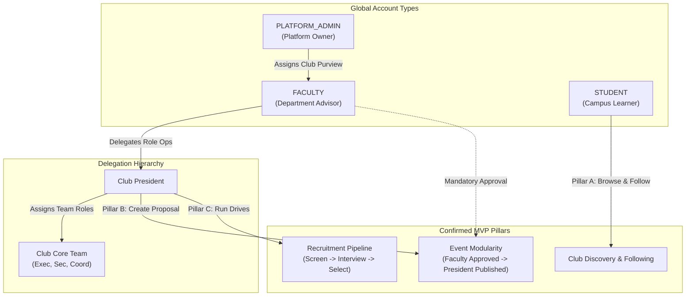
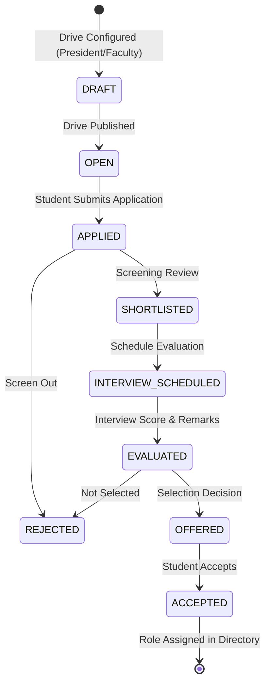
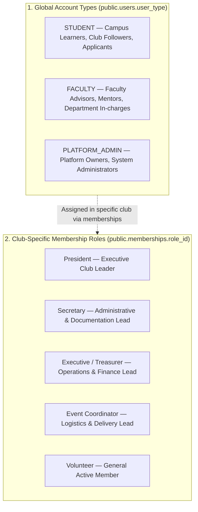
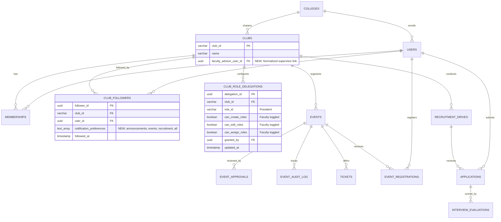
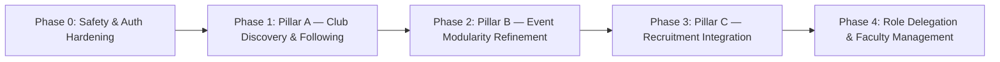

# ClubSync — Web-First MVP Architecture & System Audit

**Document Version:** 1.0.0  
**Date:** October 2026  
**Target Environment:** Web (React 19, Vite, TypeScript) + Supabase (PostgreSQL 15, Auth, Storage, Realtime)  
**Institutes in Scope:** VIT Pune (V1 Single-Campus MVP)  

---

## 1. Executive Summary & Web-First MVP Direction

ClubSync is transitioning from an exploratory multi-platform prototype into a focused, production-grade **Web-First MVP**. The primary objective is to deliver an operational campus management platform for student club discovery, faculty-governed event lifecycles, and core team recruitment drives at Vishwakarma Institute of Technology (VIT Pune).

### Core Directives
1. **Web-First Delivery:** The React + Vite web dashboard is the primary product surface for students, club leaders, faculty mentors, and platform owners.
2. **Preservation of Working Assets:** Existing business logic, components, and SQL routines are preserved and aligned rather than rewritten from scratch.
3. **Safety & Zero-Destruction:** All findings in this document represent a non-destructive audit. Production database changes, migrations, or application refactors require prior authorization.
4. **Three Unshakable Pillars:**
   * **Pillar A — Club Discovery & Following:** Authenticated students explore clubs, follow instantly with notification preferences, and manage subscriptions.
   * **Pillar B — Event Modularity:** Draft creation $\rightarrow$ mandatory faculty approval $\rightarrow$ independent president publication $\rightarrow$ distinct audit trails.
   * **Pillar C — Recruitment Modularity:** Structured recruitment drives, candidate screening, shortlisting, evaluations, and selection decisions.
5. **Decoupled Permission Architecture:** Global account types (`STUDENT`, `FACULTY`, `PLATFORM_ADMIN`) are strictly decoupled from club-specific roles (`President`, `Secretary`, `Executive`, etc.), with faculty-delegated role management.



---

## 2. Current-State Audit

A comprehensive inspection of the workspace was conducted, reviewing the web application, mobile application, database scripts, migrations, and documentation.

### 2.1 Web Application Structure (`/web`)
* **Framework:** React 19.2.8, React Router DOM 7.18.2, Vite 8.2.2, TypeScript 6.0.2.
* **Component Libraries:** `@tabler/icons-react` (primary icons), `lucide-react` (legacy icons), `chart.js` & `react-chartjs-2`, `react-sortablejs` (kanban drag-and-drop).
* **Compilation Status:** `tsc --noEmit` compiles with **0 errors**.
* **Router & Navigation:**
  * Configured in [`web/src/App.tsx`](file:///c:/Users/prana/OneDrive/Desktop/Clubsync/web/src/App.tsx).
  * Entry router [`web/src/components/RoleRouter.tsx`](file:///c:/Users/prana/OneDrive/Desktop/Clubsync/web/src/components/RoleRouter.tsx) dispatches users based on `profile.user_type`.
  * Layout system provides dedicated shells: `FacultyLayout`, `PresidentLayout`, `StudentLayout`, `ExecutiveLayout`, `SecretaryLayout`, `OwnerLayout`, `AdminLayout`, `RecruiterLayout`.

#### Audit of Web Pages & Dashboards
| Role / Area | Route | Implemented State | Assessment / Missing Pieces |
|---|---|---|---|
| **Auth** | `/login` | Functional Supabase Auth (Sign In & Sign Up) | **Critical Flaw:** Self-service role dropdown allows any user to register as `Admin` or `Recruiter`. |
| **Faculty** | `/faculty` | Functional Overview Dashboard | Queries `event_approvals` and `event_audit_log`. Displays KPIs and approval queues. Needs purview scoping. |
| **Faculty** | `/faculty/approvals` | Functional Review Queue | Rich review modal. Approves/rejects via RPC `process_event_approval`. Does not restrict by faculty club purview. |
| **Faculty** | `/faculty/ledger` | Broken / Mismatched | Linked to `FacultyLedger.tsx` querying obsolete `club_ledger` table instead of `finance_transactions`. |
| **Faculty** | `/faculty/team` | Partial | Displays users; lacks role permission delegation matrix. |
| **President** | `/president` | Functional Summary Dashboard | Queries events and stats. Has legacy references to `club_tasks` and `club_ledger`. |
| **President** | `/president/events` | Functional Kanban Desk | 8-column lifecycle kanban. Integrates `submit_event_for_approval` and `publish_event` RPCs. |
| **President** | `/president/events/new` | Functional Multi-Step Proposal | Comprehensive form with budgets, objectives, and compliance. Supports draft saving and RPC submission. |
| **President** | `/president/recruitment` | Partial Kanban | Drag-and-drop stages (`applied`, `screening`, `interview`, `selected`), but queries obsolete `club_applicants` table. |
| **Student** | `/student` | Basic Dashboard | Shows open cycles and upcoming events. Uses mismatched table queries (`recruitment_cycles`). |
| **Student** | `/student/openings` | **Placeholder Only** | `<div>BrowseOpenings Placeholder</div>`. Club discovery & following missing entirely. |
| **Student** | `/student/applications` | **Placeholder Only** | `<div>MyApplications Placeholder</div>`. |
| **Student** | `/student/events/:id` | Functional RSVP | Reads `events`, `tickets`, `event_registrations`; invokes `register_for_event` RPC. |
| **Recruiter** | `/recruiter/*` | **Placeholder Only** | 5 placeholder files: `ApplicationsView`, `Shortlisting`, `InterviewScheduler`, `EvaluationForm`, `Results`. |
| **Admin** | `/admin/*` | **Placeholder Only** | 4 placeholder files: `CreateCycle`, `ManageCycles`, `TeamFormation`, `MembersDirectory`. |
| **Owner** | `/owner` | Partial Prototype | Mockup analytics and college overview. |

### 2.2 Mobile Application Structure (`/mobile`)
* **Framework:** React Native + Expo (SDK 51+), TypeScript.
* **Services:** [`mobile/src/services/clubSyncService.ts`](file:///c:/Users/prana/OneDrive/Desktop/Clubsync/mobile/src/services/clubSyncService.ts) contains a complete CRUD client for `users`, `clubs`, `club_followers`, `events`, `event_registrations`, and `applications`.
* **Alignment with MVP:** The mobile app already implemented `club_followers` toggling and QR gate checking. However, per confirmed decisions, mobile is deferred to subsequent phases. Club committee edit tools were intentionally stripped from mobile, reserving club management exclusively for web.

### 2.3 Database Definitions & Schema Dualism
An essential discovery of this audit is that **two divergent database generations coexist in the repository**:

1. **Generation 1: Legacy Flat Prototype (`database/rls_policies.sql`, `unwanted imp files/.../setup.sql`)**
   * Uses flat, non-relational tables: `club_tasks`, `club_events`, `club_ledger`, `club_applicants`, `club_announcements`, `social_posts`, `club_profiles`.
   * Enforces roles through a global `get_my_role()` function querying `users.user_type`.
   * No concept of multi-tenancy, multi-club memberships, or delegated authority.

2. **Generation 2: Production Relational Schema (`database/schema.sql` + Patches 02–12)**
   * Master relational schema with 17+ tables: `colleges`, `users`, `clubs`, `club_roles`, `memberships`, `club_followers`, `events`, `event_approvals`, `event_audit_log`, `event_versions`, `tickets`, `event_registrations`, `recruitment_drives`, `applications`, `interview_evaluations`, `event_tasks`, `event_budgets`, `finance_transactions`.
   * Contains security-definer RPCs: `submit_event_for_approval`, `process_event_approval`, `publish_event`, `register_for_event`.

> [!WARNING]
> While modern components (`EventsDesk.tsx`, `ApprovalsQueue.tsx`, `NewEventProposal.tsx`) interact with Generation 2 tables, legacy components (`ClubContext.tsx`, `Ledger.tsx`, `FacultyLedger.tsx`, `Recruitment.tsx`, `AdminDashboard.tsx`) still issue queries against Generation 1 table names.

---

## 3. Alignment with Confirmed MVP Pillars

### 3.1 Pillar A — Club Discovery & Following

| Requirement | Confirmed Specification | Current Repository Status | Gap Analysis & Remediation |
|---|---|---|---|
| **Delivery Medium** | Web application first | Mobile has discovery; Web has placeholder `/student/openings`. | **Grave Gap:** Build student Club Discovery hub on the web (`/student/clubs`). |
| **Authentication** | Sign in required to browse | Web routes are gated via `ProtectedRoute` in `App.tsx`. | **Aligned:** Ensure unauthenticated visitors are redirected to `/login`. |
| **Following Model** | Instant, no approval needed | Database table `club_followers` exists. Mobile implements toggle. | **Web Gap:** Web components lack follow/unfollow buttons and queries. |
| **Membership Separation** | Separate from official membership | `club_followers` and `memberships` are distinct tables in `schema.sql`. | **Aligned:** Architectural separation is intact in the database schema. |
| **Notification Preferences** | User-configurable (Announcements, Events, Recruitment, All) | Schema table `club_followers` lacks notification preference columns. | **Schema Gap:** Add `notification_preferences TEXT[] DEFAULT '{"all"}'` to `club_followers`. |
| **Unfollowing** | Free to unfollow at any time | Supported in database via `DELETE FROM club_followers`. | **Aligned:** Wire delete action in web interface. |

### 3.2 Pillar B — Event Modularity

| Lifecycle Step | Confirmed Specification | Implementation Status in Codebase |
|---|---|---|
| **1. Creation** | Authorized club user creates event as `draft` | **Working:** `NewEventProposal.tsx` writes `status: 'draft'` to `events` table with full metadata. |
| **2. Submission** | Event submitted for faculty review | **Working:** `submit_event_for_approval` RPC sets status to `under_review`, creates version snapshot in `event_versions`, and initializes `event_approvals`. |
| **3. Faculty Approval** | Mandatory approval before publication | **Working:** `ApprovalsQueue.tsx` calls `process_event_approval(..., 'APPROVED')`. Sets status to `approved`. |
| **4. Non-Auto-Publish** | Approval does **not** auto-publish | **Working:** Status transitions strictly to `approved`, requiring explicit subsequent action. |
| **5. President Publish** | President publishes approved event | **Working:** `EventsDesk.tsx` renders "Publish Event" button for `approved` status, invoking `publish_event` RPC to set status to `published`. |
| **6. Audit Trail** | Approval and publication recorded separately | **Working:** Both `process_event_approval` and `publish_event` write explicit records to `event_audit_log` with user ID, timestamps, and action tags. |

#### Open Event Modularity Decisions
1. **Rejection & Revision Flow:** When faculty rejects an event, should the event allow editing and resubmission?
   * *Existing Code Pattern (Patch 08):* Introduced `changes_requested` status and enabled `submit_event_for_approval` to accept `draft` or `changes_requested`. Outright `rejected` is treated as a terminal state.
2. **Post-Approval Edits:** If event details are altered after faculty approval, should approval be automatically revoked?
   * *Existing Code Pattern:* `NewEventProposal.tsx` line 71 blocks editing any event with status other than `draft`, `changes_requested`, or `rejected`. Approved events are currently locked from edits.

### 3.3 Pillar C — Recruitment Modularity

The intended module provides an end-to-end pipeline: Drive Configuration $\rightarrow$ Application Intake $\rightarrow$ Screening $\rightarrow$ Shortlisting $\rightarrow$ Interviews / Evaluations $\rightarrow$ Selection Decisions $\rightarrow$ Results Publication.



#### Current State vs MVP Needs
* **Database Master Schema (`schema.sql`):** Fully supports `recruitment_drives`, `applications`, and `interview_evaluations`.
* **Component Divergence:**
  * `web/src/components/Recruitments.tsx` correctly targets `applications` and `interview_evaluations`.
  * `web/src/pages/president/Recruitment.tsx` incorrectly targets `club_applicants` (legacy table).
  * `web/src/pages/recruiter/*` and `web/src/pages/student/BrowseOpenings.tsx` are non-functional placeholders.
* **Coherent Proposed Workflow:** Consolidate recruitment management into the President and Faculty dashboards, targeting the canonical `recruitment_drives` and `applications` tables.

---

## 4. Dashboard and Role Direction

### 4.1 Faculty Dashboard Visual Reference Analysis
The selected Faculty Dashboard mockup (`docs/prototypes/prototypes/IMP dashboard/faculty_dashboard.html`) establishes the visual benchmark:
* **Palette:**
  * Primary Sidebar: Navy Deep (`#0F2540`, `#0A1A2E`).
  * Content Canvas: Warm Parchment (`#F7F5EF`, `#EFEBE0`).
  * Card Surfaces: Pure White (`#FFFFFF`) with 1px border (`#E1E4EA`) and soft dual shadows.
  * Accents: Sapphire Blue (`#1E4D8C`), Academic Gold (`#B8862E`), Forest Green (`#2F7A4F`), Crimson Red (`#B23A2E`).
* **Typography:**
  * Display / Headings: `Source Serif 4` / Editorial Serif.
  * Interface / Body: `Inter` / Modern Sans.
  * Metrics / Numbers / Codes: `IBM Plex Mono` / Monospace.
* **Component Layout:**
  * Fixed Left Rail (248px) with college brand mark, active purview indicator, categorized navigation links, and active user profile anchor.
  * Top Bar (62px) with hierarchical breadcrumb navigation, quick search, and notification bell with pulse indicator.
  * Dynamic Content Area with hero section, 4-column metric cards with colored accent bars, and responsive 2-column or tabbed operational panes.

### 4.2 Faculty Navigation Alignment

| Proposed Navigation Item | Current Route in `App.tsx` | Implementation Status | Action Required for Alignment |
|---|---|---|---|
| **Dashboard** | `/faculty` | Implemented (`FacultyDashboard.tsx`) | Retain. Scope KPI stats to supervised clubs. |
| **My Clubs** | *None* | Missing | Create view displaying clubs under faculty purview. |
| **Events** | `/faculty/approvals` | Implemented (`ApprovalsQueue.tsx`) | Unify proposal review and event schedule views. |
| **Members** | `/faculty/team` | Partial (`FacultyTeam.tsx`) | Wire to `memberships` table for student roster oversight. |
| **Recruitment** | *None* (Linked to `/faculty/team`) | Missing in Faculty | Add recruitment drive oversight & selection signoff. |
| **Finance** | `/faculty/ledger` | Broken (Queries `club_ledger`) | Point queries to `finance_transactions` table. |
| **Reports** | *None* (Stub in sidebar) | Missing | Implement event summary reports & NAAC audit view. |
| **Role & Permissions** | *None* | Missing | **Core Feature:** Faculty controls President role permissions. |
| **Settings** | *None* | Missing | Add account preferences and alert toggles. |

---

## 5. Permission & Delegation Architecture

### 5.1 Account Type & Role Taxonomy



### 5.2 Delegation Rules & Authorization Boundaries

1. **Faculty Purview Rule:** A user with `user_type = 'FACULTY'` possesses administrative privileges **only** for clubs where they are designated as the faculty advisor. Faculty cannot view, approve, or alter events of clubs outside their purview.
2. **Delegation of Role Management:**
   * Faculty have inherent permission to create, modify, and assign club roles within their purview.
   * A President **cannot** create or manage roles by default.
   * Faculty may explicitly grant the President three distinct, independent capabilities:
     1. `can_create_roles` — Ability to define new club-level role titles and descriptions.
     2. `can_edit_roles` — Ability to alter permissions or requirements of existing club roles.
     3. `can_assign_roles` — Ability to appoint students to or remove students from club roles.
   * Faculty can revoke any or all of these three capabilities at any time.
3. **Hierarchy Ceiling:** A President cannot assign permissions higher than their own delegated scope, nor can they revoke or modify faculty advisor appointments.
4. **Platform Admin Monopoly:** Institution creation, new club registration, initial faculty mentor appointments, and system-wide overrides remain reserved exclusively for `PLATFORM_ADMIN`.

---

## 6. Security and Database Audit

A read-only security assessment of the database and backend logic revealed several significant vulnerabilities requiring remediation prior to production launch:

### 6.1 Vulnerability Findings Matrix

| Ref | Severity | Area | Finding Summary | Impact |
|---|---|---|---|---|
| **SEC-01** | **HIGH** | Web Sign-Up (`Login.tsx`) | Role self-selection dropdown permits users to register with `user_type = 'admin'` or `'recruiter'`. | Privilege escalation; unvetted users gain access to administrative dashboards. |
| **SEC-02** | **HIGH** | Database RLS (`users`) | Policy `Users can insert/update own profile` allows `auth_user_id = auth.uid()` without `WITH CHECK` on `user_type`. | An authenticated user can update their own row to `user_type = 'SUPER_ADMIN'`. |
| **SEC-03** | **CRITICAL** | Database RLS (`events`, `finance`) | Master `schema.sql` (lines 540–549) defines development policies: `FOR ALL USING (true)`. | Anonymous or unauthorized clients can insert, update, or delete any event or financial transaction. |
| **SEC-04** | **CRITICAL** | Database RLS (`memberships`) | `ALTER TABLE memberships ENABLE ROW LEVEL SECURITY;` is completely omitted in `schema.sql`. | The entire membership table is unprotected; anyone with the anon key can read/modify club rosters. |
| **SEC-05** | **HIGH** | Backend Logic (`event_approvals`) | Queries in `ApprovalsQueue.tsx` select all pending events without verifying faculty club purview. | Faculty can approve or reject events for clubs they do not supervise. |
| **SEC-06** | **MEDIUM** | Auth Impedance (`AuthContext.tsx`) | Supabase `auth.uid()` is passed interchangeably into columns expecting internal `user_id` (UUID). | Causes foreign key violations or silent query failures for non-synced user records. |

### 6.2 Remediation Blueprint (No Changes Applied)

1. **Fix SEC-01:** Remove the role selector in `Login.tsx`. Hardcode all self-registrations to `user_type: 'STUDENT'`. Faculty and administrative accounts must be provisioned or promoted by Platform Admin.
2. **Fix SEC-02:** Alter `users` RLS policy to protect privileged columns:
   ```sql
   CREATE POLICY "Users can update own profile non_privileged" ON users
   FOR UPDATE USING (auth_user_id = auth.uid())
   WITH CHECK (
     auth_user_id = auth.uid() 
     AND user_type = (SELECT user_type FROM users WHERE auth_user_id = auth.uid())
   );
   ```
3. **Fix SEC-03 & SEC-04:** Enable RLS on `memberships` and replace open `USING (true)` policies with strict tenant checks utilizing `has_club_role` and `has_platform_role`.
4. **Fix SEC-05:** Update `ApprovalsQueue.tsx` and approval RPCs to restrict actions to events belonging to clubs where `EXISTS (SELECT 1 FROM memberships WHERE user_id = get_my_user_id() AND club_id = e.club_id AND role_id = 'Faculty_Advisor')` or `clubs.faculty_mentor_id = auth.uid()`.
5. **Fix SEC-06:** Standardize context in `AuthContext.tsx` to expose both `auth_user_id` (Supabase auth ID) and `user_id` (internal DB profile primary key).

---

## 7. Architecture Proposal & Target Data Model

### 7.1 Proposed Schema Refinements (Non-Destructive Extension)

To support the confirmed MVP pillars and delegation hierarchy without disrupting existing tables, the following targeted additions are recommended:



### 7.2 Stored Procedure (RPC) Workflow Specifications

1. `submit_event_for_approval(p_event_id UUID)`:
   * **Verification:** Caller must be President, Executive, or Platform Admin of the event's club.
   * **State Check:** Event must be `draft` or `changes_requested`.
   * **Action:** Sets `status = 'under_review'`, takes snapshot in `event_versions`, initializes `event_approvals` for faculty, logs `SUBMITTED` in `event_audit_log`.

2. `process_event_approval(p_event_id UUID, p_level VARCHAR, p_decision VARCHAR, p_remarks TEXT)`:
   * **Verification:** Caller must be the assigned Faculty Advisor for that club, or Platform Admin.
   * **Action:**
     * If `p_decision = 'APPROVED'` $\rightarrow$ status becomes `approved`.
     * If `p_decision = 'CHANGES_REQUESTED'` $\rightarrow$ status becomes `changes_requested`.
     * If `p_decision = 'REJECTED'` $\rightarrow$ status becomes `rejected`.
     * Logs action, approver ID, and remarks in `event_audit_log`.

3. `publish_event(p_event_id UUID)`:
   * **Verification:** Caller must be President, Executive, or Platform Admin of the event's club.
   * **State Check:** Event must be in `approved` status.
   * **Action:** Sets `status = 'published'`, logs `PUBLISHED` in `event_audit_log`, notifies followers based on preferences.

---

## 8. File-Level Implementation Plan

The following implementation sequence establishes a phased, non-destructive path to bring the existing codebase into full alignment with the web-first MVP direction upon explicit authorization:



### Phase 0: Safety & Auth Hardening (Prerequisite)
* **Goal:** Eliminate security vulnerabilities and ensure clean database contracts.
* **Files to Update:**
  * [`web/src/pages/Login.tsx`](file:///c:/Users/prana/OneDrive/Desktop/Clubsync/web/src/pages/Login.tsx): Lock role dropdown; force new signups to default to `STUDENT`.
  * [`web/src/context/AuthContext.tsx`](file:///c:/Users/prana/OneDrive/Desktop/Clubsync/web/src/context/AuthContext.tsx): Normalize profile state to provide both `auth_user_id` and internal `user_id`.
  * `database/schema.sql`: Author clean migration script for RLS lockdown (tighten `events`, `finance`, `memberships`).

### Phase 1: Pillar A — Club Discovery & Following (Web Student Portal)
* **Goal:** Provide authenticated student club exploration, instant following, and notification preferences.
* **Files to Update / Create:**
  * `web/src/pages/student/BrowseClubs.tsx` (NEW): Rich club directory with category chips (Technical, Cultural, Sports, etc.), search bar, follower counts, and instant "Follow / Following" toggles.
  * `web/src/pages/student/ClubDetail.tsx` (NEW): Club profile view with description, leadership contacts, upcoming events, and notification preference modal.
  * `web/src/components/NotificationPreferencesModal.tsx` (NEW): Preference picker (Announcements, Events, Recruitment, All).
  * [`web/src/layouts/StudentLayout.tsx`](file:///c:/Users/prana/OneDrive/Desktop/Clubsync/web/src/layouts/StudentLayout.tsx): Add "Explore Clubs" navigation item with search icon.
  * [`web/src/App.tsx`](file:///c:/Users/prana/OneDrive/Desktop/Clubsync/web/src/App.tsx): Register routes `/student/clubs` and `/student/clubs/:clubId`.

### Phase 2: Pillar B — Event Modularity Refinement
* **Goal:** Ensure smooth 6-step lifecycle and clear faculty approval / president publish boundary.
* **Files to Update:**
  * [`web/src/pages/faculty/ApprovalsQueue.tsx`](file:///c:/Users/prana/OneDrive/Desktop/Clubsync/web/src/pages/faculty/ApprovalsQueue.tsx): Filter queue strictly by faculty-supervised clubs.
  * [`web/src/pages/president/EventsDesk.tsx`](file:///c:/Users/prana/OneDrive/Desktop/Clubsync/web/src/pages/president/EventsDesk.tsx): Ensure approved events have prominent "Publish Event" triggers; reflect faculty remarks clearly.
  * [`web/src/pages/president/NewEventProposal.tsx`](file:///c:/Users/prana/OneDrive/Desktop/Clubsync/web/src/pages/president/NewEventProposal.tsx): Validate draft creation and smooth editing of `changes_requested` proposals.

### Phase 3: Pillar C — Recruitment Integration
* **Goal:** Connect recruitment UI to canonical `recruitment_drives` and `applications` tables.
* **Files to Update:**
  * [`web/src/pages/president/Recruitment.tsx`](file:///c:/Users/prana/OneDrive/Desktop/Clubsync/web/src/pages/president/Recruitment.tsx): Replace obsolete `club_applicants` queries with `applications` table queries; connect Kanban column drops to status update API.
  * [`web/src/pages/student/BrowseOpenings.tsx`](file:///c:/Users/prana/OneDrive/Desktop/Clubsync/web/src/pages/student/BrowseOpenings.tsx): Replace placeholder with live recruitment drive listings.
  * [`web/src/pages/student/ApplicationForm.tsx`](file:///c:/Users/prana/OneDrive/Desktop/Clubsync/web/src/pages/student/ApplicationForm.tsx): Implement application submission with PRN, CGPA, and Statement of Purpose.

### Phase 4: Role Delegation & Faculty Management Dashboard
* **Goal:** Implement the faculty visual reference mockup and permission delegation matrix.
* **Files to Update:**
  * [`web/src/layouts/FacultyLayout.tsx`](file:///c:/Users/prana/OneDrive/Desktop/Clubsync/web/src/layouts/FacultyLayout.tsx): Align sidebar navigation to the confirmed 9 items.
  * `web/src/pages/faculty/RolePermissions.tsx` (NEW): Faculty interface to toggle President's `can_create_roles`, `can_edit_roles`, `can_assign_roles`.
  * `web/src/pages/faculty/MyClubs.tsx` (NEW): List and health dashboard of supervised clubs.
  * [`web/src/pages/faculty/FacultyLedger.tsx`](file:///c:/Users/prana/OneDrive/Desktop/Clubsync/web/src/pages/faculty/FacultyLedger.tsx): Point queries to `finance_transactions`.

---

## 9. Backward Compatibility & Risk Management

1. **Dual Schema Migration Safety:** Existing production databases may contain data in both early prototype tables and generation-2 tables. Schema migrations must never `DROP TABLE` without prior data verification and backups.
2. **Mobile App Decoupling:** Changes to database RPC signatures or table columns must maintain backwards compatibility for existing mobile endpoints (`clubSyncService.ts`) by preserving parameter names and return structures.
3. **Audit Log Persistence:** All workflow actions write to `event_audit_log` without destructive overwrites, guaranteeing accountability for faculty and administrative oversight.

---

## 10. Summary of Modified & Maintained Documentation

* **[`docs/architecture/CLUBSYNC_DECISIONS.md`](file:///c:/Users/prana/OneDrive/Desktop/Clubsync/docs/architecture/CLUBSYNC_DECISIONS.md)** (NEW): Created as the canonical architecture decision log, capturing confirmed rules, technical recommendations, and open product questions.
* **[`docs/architecture/CLUBSYNC_MVP_ARCHITECTURE.md`](file:///c:/Users/prana/OneDrive/Desktop/Clubsync/docs/architecture/CLUBSYNC_MVP_ARCHITECTURE.md)** (NEW): Created as the master architecture, security audit, and implementation blueprint for the web-first MVP.
